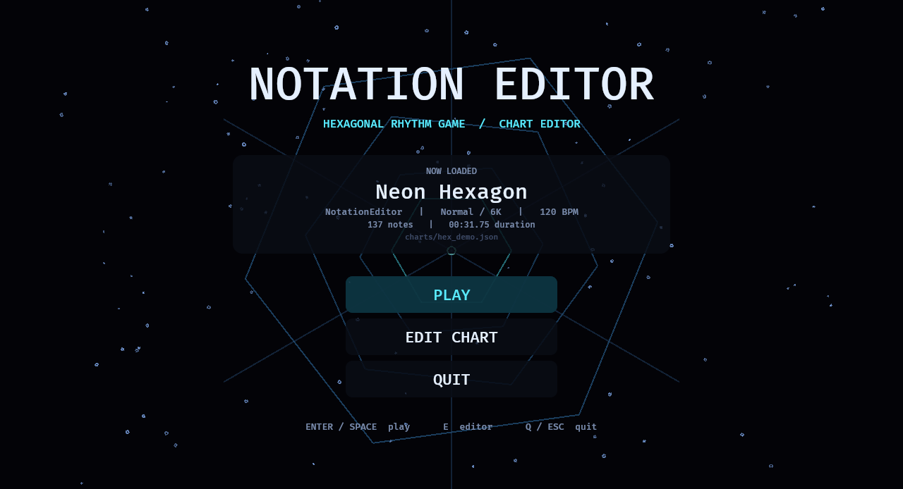
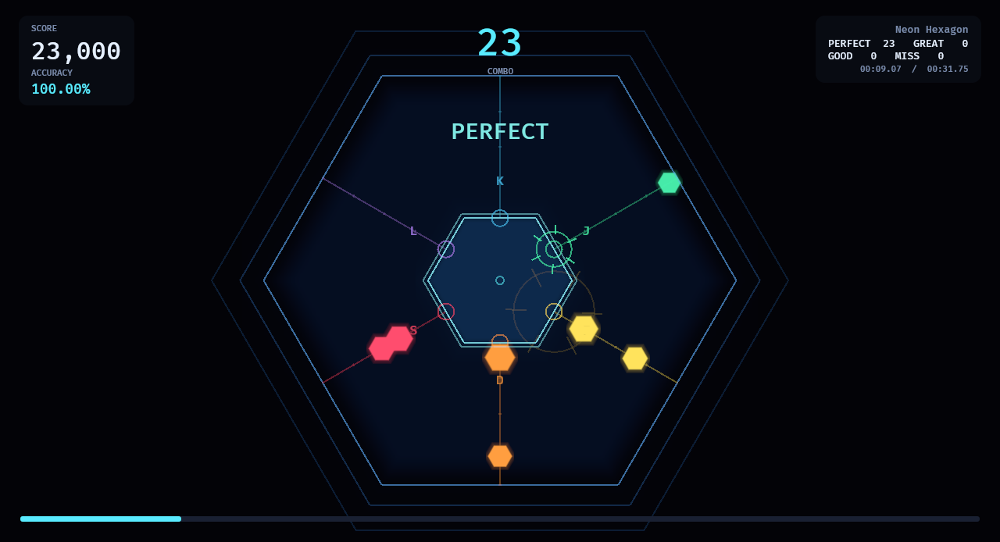
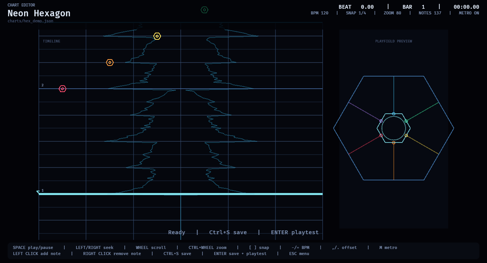
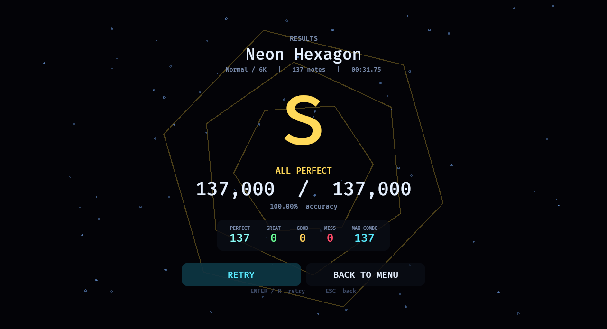

# NotationEditor

> **六边形下落式音乐游戏 × 内置制谱器**
>
> Rust · Bevy 0.16 · MVP v0.1

NotationEditor 将六条轨道排成六边形，音符从外环沿辐条飞向中心的判定环。你可以在同一个程序里游玩、创作、试听、保存和再次编辑谱面，而不需要在游戏与外部编辑器之间切换。

这个仓库原本是一个基于网格和音频波形的小型实验项目。本次重构删除了旧的 README 与旧模块，围绕“可玩的游戏 + 可用的制谱器”重新划定了范围，并完成了第一个可运行 MVP。

---

## 截图

| 主菜单 | 游戏 |
| --- | --- |
|  |  |
| **制谱器** | **结算** |
|  |  |

> 截图由项目自带截图模式生成；当前测试机使用软件 OpenGL 渲染，因此实际帧率不代表正常显卡环境。

---

## 1. 重新规划

旧版本的问题：

- 只有“轨道 + 拍点”的静态网格，没有真正的玩法；
- 音频路径硬编码为 `b.wav`，仓库里没有该文件；
- 没有谱面文件格式、保存/加载、判定、计分或结算；
- 所谓“六边形”只存在于项目描述中，代码里并没有六边形几何。

新版本的 MVP 目标与完成情况：

- [x] 6 条从六边形外缘指向中心判定环的轨道；
- [x] 完整判定窗口、分数、连击、准确率、评级；
- [x] 可暂停、重开、退出，以及自动演示模式；
- [x] 六边形音游画面（非网格占位）；
- [x] 基于拍点的谱面 JSON 格式与校验；
- [x] 制谱器：时间轴、六边形预览、音频波形、吸附、BPM/偏移、节拍器；
- [x] 制谱器内保存、直接试玩，并形成“编辑 → 保存 → 试玩 → 结算 → 回到编辑器”的闭环；谱面通过 `--chart` 载入；
- [x] 内置原创演示曲、演示谱面、音效，开箱即玩；
- [x] 无头自检模式与 43 个单元测试；
- [x] 键盘与鼠标均可操作，不依赖外部美术资源。

MVP 明确**不做**：长按音符、变速 BPM、撤销/重做、文件选择器、在线谱面、录像回放。这些放在路线图中。

---

## 2. 特性

### 游戏

- **六边形 6K 下落式玩法**：音符从六边形外环飞向中心，按键 `S D F J K L` 对应六条辐条。
- **判定与反馈**：Perfect / Great / Good / Miss，带误差毫秒反馈、命中扩散特效和连击断连。
- **HUD**：分数、实时准确率、连击、判定统计、时间、进度条。
- **暂停菜单**：暂停、重开、返回菜单。
- **自动演示**：`--autoplay` 适合展示、截图和端到端冒烟测试。
- **结算页**：评级、分数/满分、准确率、最大连击、各判定数量、All Perfect / Full Combo 徽章。

### 制谱器

- 六列时间轴，固定播放头，未来音符向上滚动。
- 左侧点击添加音符，右键删除音符；按 1/1 到 1/16 吸附。
- 右侧实时六边形预览，显示当前播放头时刻的判定线附近音符。
- 自动解码谱面音频并绘制波形轮廓（OGG/WAV 解码由 Symphonia 完成）。
- 播放头预览带节拍器；可单独关闭节拍器。
- BPM 与音频偏移可直接调整，修改后立即影响试玩。
- `Ctrl+S` 原子保存（临时文件 + rename），并做完整格式校验。
- `Enter` 保存并直接进入游戏试玩；从结算页返回编辑器时重新读取磁盘谱面。
- 未保存退出有二次确认，标题栏用 `*` 标记 dirty 状态。

### 工程

- 纯核心逻辑与 Bevy 表现层分离，核心可无头测试。
- 谱面格式带版本号、范围校验和重复音符检查。
- 程序化生成六边形辉光贴图，不依赖 PNG 精灵资源。
- 自带原创 33.5 秒演示曲、点击音效和 137 音符演示谱面。
- `--selftest`：不打开窗口、不初始化音频设备，验证谱面 IO、判定与计分。
- `--screenshot`：开发用截图模式，可对菜单/游戏/编辑器/结算自动截图。

---

## 3. 快速开始

### 环境要求

- Rust 1.85+（项目使用 edition 2024）；
- Linux 需要常见的 Bevy 依赖（ALSA、udev 等）；
- 只有重新生成演示曲时才需要 `ffmpeg` 和 Python 3；
- Windows / macOS 理论上可编译，但当前 MVP 只在 Linux 上验证过。

### 运行

```bash
git clone https://github.com/Core2002/NotationEditor.git
cd NotationEditor
cargo run
```

直接试玩演示谱面：

```bash
cargo run -- --play
```

自动演示（自动命中所有音符，适合展示）：

```bash
cargo run -- --play --autoplay
```

进入编辑器：

```bash
cargo run -- --editor
```

加载自己的谱面：

```bash
cargo run -- --chart charts/my_song.json --play
```

查看全部命令行参数：

```bash
cargo run -- --help
```

### 无 GPU / 软件渲染环境

如果机器没有 Vulkan 驱动，可强制使用 OpenGL 软件渲染（本项目的 CI 验证环境即如此）：

```bash
WGPU_BACKEND=gl LIBGL_ALWAYS_SOFTWARE=1 cargo run -- --play
```

在 Wayland 会话中如果窗口和 wgpu 后端不一致，可额外取消 `WAYLAND_DISPLAY` 并强制 X11：

```bash
env -u WAYLAND_DISPLAY WGPU_BACKEND=gl LIBGL_ALWAYS_SOFTWARE=1 cargo run -- --play
```

正常情况下不需要这些环境变量。

### 音频格式

内置构建默认支持 **OGG / Vorbis**（Bevy 默认 feature），演示曲就是 OGG。
如果要让游戏直接播放 WAV/MP3，请在 `Cargo.toml` 中为 `bevy` 启用 `wav`/`mp3` feature 后重新编译：

```toml
bevy = { version = "0.16", features = ["wav", "mp3"] }
```

制谱器的波形解码使用 Symphonia，已支持 OGG 与 WAV。

---

## 4. 操作

### 主菜单

| 操作 | 按键 |
| --- | --- |
| 开始游戏 | `Enter` / `Space` / 点击 PLAY |
| 进入编辑器 | `E` / 点击 EDIT CHART |
| 退出 | `Q` / `Esc` / 点击 QUIT |

### 游戏

| 操作 | 按键 |
| --- | --- |
| 六条轨道 | `S` `D` `F` `J` `K` `L` |
| 暂停 / 继续 | `Esc` |
| 暂停时重开 | `R` |
| 暂停时返回菜单 | `Q` |
| 结算页重试 | `Enter` / `R` |
| 结算页返回 | `Esc` / 点击按钮 |

### 编辑器

| 操作 | 按键 |
| --- | --- |
| 播放 / 暂停预览 | `Space` |
| 向前 / 向后移动播放头 | `→` / `←`（`Shift` 一次 4 拍） |
| 跳到开头 / 结尾 | `Home` / `End` |
| 前后翻 4 拍 | `PageUp` / `PageDown` |
| 滚动时间轴 | 鼠标滚轮（`Shift` 更细） |
| 缩放时间轴 | `Ctrl` + 鼠标滚轮 |
| 添加音符 | 时间轴内左键 |
| 删除音符 | 时间轴内右键（吸附格附近） |
| 调整吸附 | `[` 更粗 / `]` 更细（1/1 … 1/16） |
| 调整 BPM | `-` / `=`（`Shift` 步长 10） |
| 调整音频偏移 | `,` / `.`（`Shift` 100ms） |
| 节拍器开关 | `M` |
| 保存 | `Ctrl+S` |
| 保存并试玩 | `Enter` |
| 返回菜单 | `Esc`（有未保存修改时需按两次） |

编辑器约定：

- 播放头固定在时间轴下部，未来音符在上方；
- 左键是“在该格写音符”，不是“跳转播放头”；跳转请用滚轮或方向键；
- 时间轴上的六列对应游戏中的六个按键；
- 保存/试玩会校验谱面，非法数据会以状态栏错误提示且不切换界面。

---

## 5. 判定、计分与评级

### 判定窗口

| 判定 | 时间误差 | 单音符得分 | 权重 |
| --- | --- | ---: | ---: |
| Perfect | ≤ 45 ms | 1000 | 1.00 |
| Great | ≤ 90 ms | 700 | 0.70 |
| Good | ≤ 140 ms | 400 | 0.40 |
| Miss | > 140 ms 未命中 | 0 | 0.00 |

- 同一轨道上取距离当前时间最近的未判定音符；
- 按键时若附近没有可判定音符，记为 ghost tap，不扣分、不中断连击；
- 超过 Good 窗口的音符自动 Miss，并中断连击。

### 分数与准确率

```text
score      = Σ 每个音符的得分
max_score  = 音符总数 × 1000
accuracy   = score / max_score
combo      = 连续命中数（Perfect/Great/Good 都算命中）
```

**连击不提供分数倍率**，只作为表现与结算指标；因此分数完全由判定质量决定。

### 评级

| 评级 | 准确率 |
| --- | --- |
| S | ≥ 95% |
| A | ≥ 90% |
| B | ≥ 80% |
| C | ≥ 70% |
| D | 其余 |

- `Full Combo`：没有 Miss；
- `All Perfect`：全部 Perfect；
- 最后一个音符判定后等待 2.2 秒进入结算。

### 自动演示

`--autoplay` 会在每个音符的精确命中时刻触发按键，因此结果是 100% 准确率、全 Perfect。它用于验证整条“谱面 → 判定 → HUD → 结算”链路，也可用来录制展示素材。

---

## 6. 谱面格式 v1

### 示例

```json
{
  "format": 1,
  "title": "Neon Hexagon",
  "artist": "NotationEditor",
  "charter": "NotationEditor",
  "difficulty": "Normal / 6K",
  "bpm": 120.0,
  "offset_ms": 0.0,
  "approach_ms": 1800.0,
  "audio": "audio/hex_demo.ogg",
  "notes": [
    { "lane": 0, "beat": 4.0 },
    { "lane": 1, "beat": 5.0 },
    { "lane": 2, "beat": 6.0 },
    { "lane": 5, "beat": 6.5 }
  ]
}
```

### 字段

| 字段 | 类型 | 说明 |
| --- | --- | --- |
| `format` | u32 | 格式版本，当前为 `1` |
| `title` | string | 曲名，不能为空 |
| `artist` | string | 曲师 |
| `charter` | string | 谱师 |
| `difficulty` | string | 难度显示文本 |
| `bpm` | f64 | 30–300，固定 BPM |
| `offset_ms` | f64 | 第 0 拍对应的音频时间，0–60000ms |
| `approach_ms` | f64 | 音符从生成到判定环的用时，500–5000ms |
| `audio` | string/null | 相对 `assets/` 的路径；`null` 表示只用节拍器 |
| `notes` | array | `{ lane, beat }`，按 `beat`、`lane` 排序保存 |

### 时间定义

```text
note_time(seconds) = offset_ms / 1000 + beat * 60 / bpm
```

- `beat` 是拍位置，不是秒；改 BPM 会自动重排整首谱面的时间。
- `offset_ms` 是“第 0 拍在音频中的位置”。正值表示音频先播放一段再开始谱面。
- `audio` 相对 Bevy 的 `assets/` 根目录解析；例如 `audio/hex_demo.ogg` 对应 `assets/audio/hex_demo.ogg`。
- 路径不能是绝对路径，也不能包含 `..`。

### 校验规则

- `format` 必须为 1；
- `title` 非空；
- BPM、offset、approach 在规定范围内且为有限数；
- 轨道 0–5，拍位置 ≥ 0 且 ≤ 1,000,000；
- 最多 50,000 个音符；
- 同轨道同拍不能重复；
- 读取时会自动排序；保存时使用临时文件 + rename，避免写一半导致谱面损坏。

如果音频文件不存在，游戏会记录警告并回退到节拍器；谱面本身仍可游玩。

---

## 7. 目录结构

```text
.
├── assets/
│   ├── audio/
│   │   ├── hex_demo.ogg       # 原创演示曲
│   │   ├── click.ogg          # 普通节拍器
│   │   └── click_accent.ogg   # 小节重音节拍器
│   └── ...
├── charts/
│   └── hex_demo.json          # 演示谱面（137 notes）
├── docs/
│   ├── menu.png
│   ├── play.png
│   ├── editor.png
│   └── results.png
├── src/
│   ├── main.rs                # 进程入口
│   ├── lib.rs                 # Bevy App 组装、状态机、截图/资源根
│   ├── chart.rs               # 谱面模型、校验、JSON IO、时间换算
│   ├── game.rs                # 判定窗口、Session、计分、评级
│   ├── geometry.rs            # 六边形与轨道几何、音符运动
│   ├── audio.rs               # 音频资源预加载、歌曲/点击音
│   ├── waveform.rs            # Symphonia 波形峰值解码
│   ├── theme.rs               # 调色板、程序化贴图、按钮样式
│   ├── menu.rs                # 主菜单
│   ├── play.rs                # 游戏画面、HUD、暂停/重开
│   ├── editor.rs              # 时间轴编辑器、波形、预览、保存
│   ├── results.rs             # 结算页
│   ├── selftest.rs            # 无头自检
│   ├── cli.rs                 # 命令行参数与谱面加载回退
│   └── shaders/
│       └── fullscreen.wgsl    # 精简 2D 渲染图所需的全屏顶点着色器
├── tools/
│   └── generate_demo.py       # 重新生成演示曲、音效和谱面
├── Cargo.toml
└── README.md
```

旧版的 `debug_tools.rs`、`grid.rs`、`input.rs`、`note.rs`、`score.rs`、`time_domain_graph.rs` 已移除，其职责被拆分并重写。

---

## 8. 设计说明

### 状态机

```text
Menu ──Enter/PLAY──▶ Play ──所有音符判定 + 2.2s──▶ Results
  ▲                    │                              │
  │                    └────────Esc/Q─────────────────┤
  │                                                   │
  └──────────────────Esc──────────────────────────────┘
  │
  └──E──▶ Editor ──Enter 保存并试玩──▶ Play ──▶ Results ──Esc──▶ Editor
```

`Menu` / `Play` / `Editor` / `Results` 由 Bevy `States` 管理，界面实体通过 `StateScoped` 自动清理。`GameSession` 在结算页被读取，下一次开始时重新创建。

### 时间与音频

- 游戏时钟使用 `Time<Real>` 的墙钟增量，而不是依赖音频 sink 的内部位置；
- 暂停时同时暂停时钟和歌曲 `AudioSink`；恢复时继续；
- 歌曲在谱面有可用音频时播放；否则按整拍生成节拍器点击音；
- 制谱器预览只使用节拍器，因此可以从任意播放头位置开始，无需音频 seek；
- 缺失音频、无效谱面、保存失败都会在 UI/日志中给出可理解的反馈，而不是 panic。

### 渲染

- 六边形辉光贴图由 CPU 逐像素生成（白色软边六边形 + 外发光），通过 `Sprite` 染色为六条轨道的颜色；
- 轨道、判定环、节拍脉冲、命中/失误特效使用 Bevy `Gizmos` 立即模式绘制；
- HUD、菜单、编辑器 UI 使用 Bevy UI，字体使用 Bevy 内置默认字体；
- 为了让软件 OpenGL / llvmpipe 也能运行，程序只装配了 2D 渲染图：
  - 禁用 `PbrPlugin`；
  - 禁用默认 `CorePipelinePlugin`，只加入 `Core2dPlugin` + `BlitPlugin` + `TonemappingPlugin` + `UpscalingPlugin`；
  - 手动加载 `fullscreen.wgsl`，因为默认管线在 `CorePipelinePlugin` 中顺带加载它。
- 这不是常规 Bevy 2D 项目的默认配置，但在没有 Vulkan 的 CI/VM 中能让 MVP 正常启动和截图。

### 资源根路径

`cargo run` 时可执行文件位于 `target/debug/`，而 Bevy 默认会到可执行文件旁找 `assets/`。本项目在 `asset_root()` 中按以下顺序选择：

1. 可执行文件旁的 `assets/`（发布分发）；
2. `CARGO_MANIFEST_DIR/assets/`（cargo run / cargo install）；
3. 当前工作目录的 `assets/`。

因此从仓库根目录运行 `cargo run` 可以正确找到演示曲和点击音效。

### 制谱器数据流

```text
LoadedChart ──clone──▶ EditorSession.chart
                           │
        左/右键 / BPM / offset / snap
                           ▼
                     EditorSession.chart
                           │
              Ctrl+S ──────┼────── Enter
                           ▼          ▼
                     JSON 文件    LoadedChart → GameSession
```

试玩前会自动保存，保证从结算页返回编辑器时磁盘与内存中的谱面一致。

---

## 9. 测试与验证

### 单元测试

```bash
cargo test
```

当前共 **43** 个测试，覆盖：

- 谱面时间换算、JSON 往返、原子保存/读取、重复音符、非法字段；
- 三种判定窗口、ghost tap、自动 Miss、连击中断、评级、结算摘要；
- 轨道角度、六边形几何、音符外环/判定环位置、可见窗口；
- 波形峰值下采样与真实 WAV 解码；
- 命令行参数解析、资源路径规范化；
- 编辑器的时间轴吸附、坐标换算、seek 边界、保存后 `LoadedChart` 更新。

### 无头自检

```bash
cargo run -- --selftest
```

输出示例：

```text
NotationEditor self-test
========================
chart: Neon Hexagon  |  Normal / 6K  |  137 notes  |  120 BPM
PASS chart validation
PASS JSON round-trip
PASS save/load round-trip
PASS perfect autoplay (137 notes, 137,000 pts, accuracy 100.00%, rank S)
PASS mixed run (P86 G16 O8 M27, combo 110, accuracy 73.28%, rank C)
========================
all checks passed
```

### 截图模式（开发用）

```bash
cargo run -- --screenshot docs/menu.png --screenshot-delay 3
cargo run -- --play --autoplay --screenshot docs/play.png --screenshot-delay 9
cargo run -- --editor --screenshot docs/editor.png --screenshot-delay 6
cargo run -- --play --autoplay --screenshot docs/results.png --screenshot-delay 37
```

截图通过 Bevy 的 `Screenshot` + `save_to_disk` 完成，截图后程序自动退出。该模式主要用于验证渲染链路和生成 README 图片。

### 重新生成演示资源

```bash
python3 tools/generate_demo.py
```

脚本会用纯 Python 合成 120 BPM、33.5 秒的立体声演示曲（无版权问题），并生成点击音效与 `charts/hex_demo.json`。需要 `ffmpeg`（libvorbis 编码器）。生成逻辑是确定性的，便于复现。

---

## 10. MVP 范围与路线图

### 已完成

- [x] 六边形 6K 游戏画面与完整判定/计分/评级；
- [x] 菜单、游戏、暂停、结算、重试；
- [x] 制谱器时间轴、预览、波形、吸附、BPM/offset 编辑；
- [x] 谱面 JSON 格式、校验、原子保存、加载回退；
- [x] 内置演示曲、谱面、音效；
- [x] 无头自检、43 个测试、截图模式；
- [x] 软件 OpenGL 环境可运行。

### 后续路线

1. **长按音符（Hold）**：数据格式预留，判定与渲染需要扩展。
2. **变速 BPM / 节拍线**：在格式中增加 BPM 事件列表，时间换算改为分段积分。
3. **编辑器体验**：撤销/重做、框选、拖拽绘制、复制粘贴、播放头跟随试听、文件选择器。
4. **音频体验**：WAV/MP3 默认支持、音频偏移校准向导、节拍器音量、主音量设置。
5. **谱面管理**：谱面浏览器、封面/预览、难度列表、最近打开。
6. **回放与分享**：录制判定序列、回放、谱面导入导出。
7. **输入与可访问性**：手柄、自定义键位、判定偏移、色盲配色、界面缩放。
8. **本地化**：内置字体不含 CJK；可打包 Noto Sans CJK 子集并提供中英切换。
9. **打包**：Windows/macOS 构建、发布压缩包、Steam/itch 分发包。

### 已知限制

- 只支持固定 BPM 与单点 Tap 音符；
- UI 使用英文 ASCII，Bevy 默认字体不包含中日韩字形；谱面元数据里写中文也会显示为方框；
- 判定时钟基于系统墙钟，没有“音频延迟校准”；
- 编辑器没有撤销/重做与文件拾取器，路径通过 `--chart` 指定；
- 退出编辑器不会自动保存，需要显式 `Ctrl+S` 或 `Enter`；
- 软件渲染下帧率很低，但逻辑与截图流程正常；
- 仅验证 Linux；Windows/macOS 需要自行补齐构建依赖与测试。

---

## 11. 许可证

本项目使用 MIT License，详见 [LICENSE](LICENSE)。

## 12. 致谢

- [Bevy](https://bevyengine.org/)：ECS、渲染、UI、音频与输入；
- [Symphonia](https://github.com/pdeljanov/Symphonia)：编辑器波形解码；
- [Serde](https://serde.rs/) / [serde_json](https://github.com/serde-rs/json)：谱面序列化；
- `ffmpeg` / libvorbis：演示曲 OGG 编码；
- Bevy 内置默认字体。

---

**NotationEditor** · 让谱面编辑和游玩发生在同一个六边形里。
